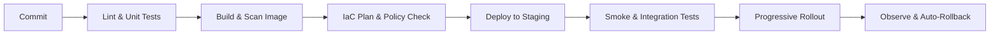

<div align="center">
  

  
  [](https://linkedin.com/in/YOUR_LINKEDIN)
  [](mailto:you@example.com)
</div>

---

## 📄 profile.yaml

```yaml
apiVersion: v1
kind: Engineer
metadata:
  name: YOUR NAME
  role: DevOps / Platform / SRE
  experience: X+ years
spec:
  focus:
    - CI/CD pipeline design and optimisation
    - Kubernetes platform operations
    - Infrastructure as Code (Terraform)
    - Observability and incident response
    - DevSecOps and supply-chain security
  principles:
    - "Automate the toil, document the exceptions"
    - "If it isn't monitored, it isn't production"
    - "Immutable infrastructure, repeatable deployments"
    - "Blameless postmortems, measurable improvements"
  currentlyLearning: [eBPF, Platform Engineering, FinOps]
```

---

## 🔄 How I Ship



---

## 🧰 Toolchain

| Layer | Tools |
|---|---|
| **Cloud** |    |
| **Containers** |     |
| **IaC & Config** |   |
| **CI/CD** |    |
| **Observability** |    |
| **Security** |    |
| **Scripting** |    |

---

## 🚀 Featured Projects

| Project | What it does | Stack |
|---|---|---|
| [**project-one**](https://github.com/YOUR_USERNAME/project-one) | Multi-environment AWS infrastructure with reusable Terraform modules | `Terraform` `AWS` `GitHub Actions` |
| [**project-two**](https://github.com/YOUR_USERNAME/project-two) | GitOps Kubernetes deployments with automated rollbacks | `Argo CD` `Helm` `EKS` |
| [**project-three**](https://github.com/YOUR_USERNAME/project-three) | Monitoring stack with SLO-based alerting and dashboards | `Prometheus` `Grafana` |
| [**project-four**](https://github.com/YOUR_USERNAME/project-four) | CI pipeline with image scanning, SAST and policy gates | `Jenkins` `Trivy` `SonarQube` |

---

## 📊 GitHub Activity

<div align="center">


</div>

---

## 📝 Runbook: Working With Me

- **Best contact:** LinkedIn or email: `you@example.com`
- **Open to:** DevOps/SRE roles, open-source contributions, platform tooling collaboration
- **Ask me about:** Terraform module design, Kubernetes troubleshooting, CI/CD optimisation

<div align="center">

⭐ If something here is useful, feel free to star a repo.

</div>
