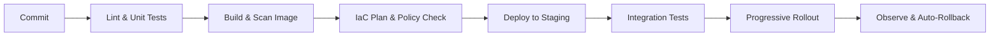

  

  
  
  

 

## 👋 About

I'm **Sandeep M**, a DevOps and Platform engineer. I design and run the delivery pipelines, cloud infrastructure and observability that let teams release often, recover quickly and sleep well.

I care about **repeatable infrastructure**, **fast feedback loops** and **security that ships with the code**, not bolted on afterwards.

 

## 🧩 What I Do

<table>
<tr>
<td width="33%" valign="top">

### ⚙️ Delivery Automation
- CI/CD pipeline design and optimisation
- GitOps workflows with Argo CD
- Release strategies: blue-green, canary, rollback
- Build caching and pipeline speed-ups

</td>
<td width="33%" valign="top">

### ☁️ Cloud &amp; Platform
- Infrastructure as Code with Terraform
- Kubernetes operations and Helm packaging
- Multi-environment AWS / Azure setups
- Configuration management with Ansible

</td>
<td width="33%" valign="top">

### 🛡️ Reliability &amp; Security
- Monitoring and alerting (Prometheus, Grafana)
- SLOs, runbooks and incident response
- Image scanning, secrets and policy checks
- Blameless postmortems

</td>
</tr>
</table>

 

## 🔄 How I Ship

 

## 🧰 Tech Stack

| | |
|---|---|
| **Cloud** |  |
| **Containers** |  |
| **IaC &amp; Config** |  |
| **CI/CD** |  |
| **Observability** |  |
| **Scripting &amp; OS** |  |

 

## 🚀 Featured Projects

| Project | What it does | Built with |
|---|---|---|
| [**project-one**](https://github.com/Sandeep-2929/project-one) | Multi-environment AWS infrastructure from reusable Terraform modules | `Terraform` `AWS` `GitHub Actions` |
| [**project-two**](https://github.com/Sandeep-2929/project-two) | GitOps Kubernetes deployments with automated rollback | `Argo CD` `Helm` `Kubernetes` |
| [**project-three**](https://github.com/Sandeep-2929/project-three) | Monitoring stack with SLO-based alerting and dashboards | `Prometheus` `Grafana` |
| [**project-four**](https://github.com/Sandeep-2929/project-four) | CI pipeline with image scanning, SAST and policy gates | `Jenkins` `Trivy` `SonarQube` |

 

## 📊 GitHub Stats

  
  

 

## 🤝 Let's Connect

I'm open to **DevOps, Platform and SRE roles**, and to collaborating on open-source infrastructure tooling.

Ask me about **Terraform module design**, **Kubernetes troubleshooting** and **CI/CD optimisation**.

